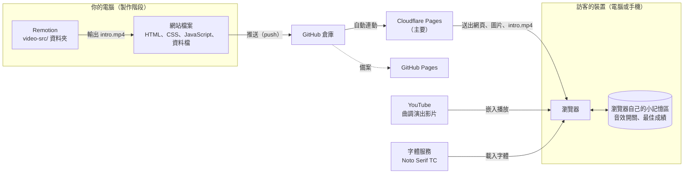

# 歌仔戲小百科網站 架構文件

日期：2026-11-13
對應需求：`docs/requirements.md`（以下簡稱「需求文件」）、以及 2026-11-13 的需求問答。

> 這份文件給不寫程式的人看。每個專有名詞第一次出現時，會用一句話解釋。
> 這份文件只講「網站怎麼組成、為什麼這樣選」，**不含程式碼**，也不規定顏色與樣式（那是畫面設計的工作）。
>
> **與需求文件不同的地方**（共 4 處，都在文中說明原因）：
> 1. 網站檔案放進 `site/` 資料夾，而不是放在倉庫最外層（見第 11、12 節）。
> 2. 片頭動畫 `intro.mp4` 上限從 30MB 降到 20MB（見第 9 節）。
> 3. 資料檔用 `.js` 而不是 `.json`（見第 3 節）。
> 4. 不使用音檔，音效改由瀏覽器即時產生（見第 3 節）。

---

## 1. 專案說明與目標

**這是什麼**：一個介紹歌仔戲的小百科網站，是課堂期末作業，老師會用網址打開來看。

**誰會看**：老師、同學，以及沒接觸過歌仔戲的一般人。所以文字要淺白，專有名詞要有白話解釋。

**網站內容（共八個單元）**

| 單元 | 內容 | 頁面 |
|---|---|---|
| 1 | 起源與歷史 | `history.html` |
| 2 | 演出形式：民戲、外台公演、內台劇場公演 | `performance.html` |
| 3 | 角色行當（角色的分類） | `roles.html` |
| 4 | 扮仙儀式：三仙會、醉八仙、天官賜福 | `xianxi.html` |
| 5 | 經典四大曲調 | `music.html` |
| 6 | 服裝道具 | `costume.html` |
| 7 | 後台秘辛：劇團小禁忌、劇團冷知識 | `backstage.html` |
| 8 | 小遊戲：翻牌配對、看圖猜行當 | `games.html` |

另外有兩個不算單元的頁面：首頁 `index.html`、參考資料 `sources.html`。

**成功標準**（沿用需求文件，並加上問答中的決定）

1. 老師點網址，在電腦和手機上都能正常瀏覽。
2. 八個單元齊全，每頁有文字、圖片位置、影片位置。
3. 翻牌配對與小測驗可以正常玩。
4. 所有文字與圖片都有可查證的出處，老師在每個單元頁底部就能看到這頁用了哪些來源。

**已確認的使用方式**（來自需求問答）

- 單元頁：開頭一段短介紹，下面是可點開的小卡片。
- 文字份量：很精簡，一個單元頁約 1 到 2 分鐘讀完，卡片只有兩三句話。
- 曲調頁：嵌入網路上現有的演出影片，不另外放音檔。
- 小測驗的圖：目前沒有照片，先用灰色預留圖。
- 首頁片頭動畫：打開就靜音自動播放，想聽聲音再按。
- 翻牌成績：瀏覽器記住最佳成績，破紀錄時有鼓勵訊息。
- 音效：預設關閉。
- 名詞解釋：點一下彈出小卡。

---

## 2. 整體架構圖

這個網站是「**靜態網站**」：網頁檔案做好就放在那裡，使用者來的時候原封不動送給他，**不需要有一台伺服器在背後算東西**。互動（翻牌、測驗、彈出解釋）全部由使用者的瀏覽器自己完成。

名詞：
- **倉庫（repository，簡稱 repo）**：存放專案所有檔案的資料夾，放在 GitHub 這個網站上，會記錄每次修改的歷史。
- **Cloudflare Pages**：一個免費的網站代管服務。它連著你的 GitHub 倉庫，倉庫一更新，網站就自動更新。
- **GitHub Pages**：GitHub 自己提供的網站代管服務，本專案當備案。
- **YouTube 嵌入**：把 YouTube 的影片播放器放進自己的網頁裡，影片本身仍存在 YouTube，不佔用本站空間。
- **Remotion**：用程式碼製作影片的工具，這裡只用來做片頭動畫。



**怎麼看這張圖**

- 左邊是你製作網站的地方。做好的檔案推到 GitHub 倉庫。
- 倉庫更新後，Cloudflare Pages 自動把新版本放到網路上。
- 訪客的瀏覽器向 Cloudflare Pages 要網頁，之後所有互動都在自己的裝置上完成。
- **沒有資料庫，也沒有任何會寫入資料的伺服器。** 訪客的最佳成績只存在他自己的瀏覽器裡，不會傳到任何地方。
- 唯一會連到本站以外的，只有 YouTube 影片和字體。

---

## 3. 技術選擇

每一項都寫「選了什麼」和「為什麼」。

### 3.1 網頁語言與框架

**選了什麼**：純 HTML、CSS、JavaScript，**不使用框架**，也沒有「建置步驟」。

名詞：
- **HTML**：決定網頁上有哪些內容（標題、段落、圖片）的語言。
- **CSS**：決定內容長什麼樣子（排版、顏色）的語言。
- **JavaScript**：讓網頁能互動（點了會有反應）的語言。
- **框架**：別人寫好的一整套程式工具，用來更快做複雜網頁。
- **建置步驟**：把原始程式先經過一道轉換，才變成能放上網的檔案。

**為什麼**
- 這個網站頁數固定、內容固定，互動只有翻牌、測驗、彈出小卡，不需要框架的能力。
- 沒有建置步驟，代表**你改一個字、存檔、推送，網站就更新了**，不用安裝工具，不會遇到「在我的電腦能跑、上線就壞」的問題。
- 老師如果想看原始碼，打開就是看得懂的檔案。

### 3.2 資料放哪裡

**選了什麼**：卡牌、題目、名詞解釋、出處清單，各自放在 `site/data/` 裡的**資料檔**，檔案格式用 `.js`（需求文件寫的是 `.json`）。

**為什麼改成 `.js`**
- `.json` 是一種純資料格式，但瀏覽器直接用雙擊打開網頁時（網址是 `file://` 開頭），**不允許網頁讀取同資料夾的 `.json`**，會造成遊戲和名詞解釋壞掉，而且看不出原因。
- 改成 `.js`，雙擊 `index.html` 就能正常運作，你自己檢查、Playwright 檢查都方便。
- 內容與格式不變，只是檔名不同。

### 3.3 單元內容放哪裡

**選了什麼**：單元的文字直接寫在各頁的 HTML 裡，不放進資料檔。

**為什麼**：文字很精簡、頁面固定，直接寫在頁面裡最容易修改；搜尋引擎和螢幕閱讀器也讀得到。需要重複使用的東西（名詞解釋、出處、遊戲資料）才集中放資料檔。

### 3.4 卡片展開

**選了什麼**：用瀏覽器內建的「可展開區塊」來做小卡片，點標題展開、再點收起。

**為什麼**：瀏覽器本來就有這個功能，鍵盤可以操作，螢幕閱讀器也知道它是「可展開」的。不用自己寫展開邏輯，不容易壞。

### 3.5 共用的導覽列與頁尾

**選了什麼**：由 `js/layout.js` 在每頁自動輸出同一份導覽列和頁尾。

**為什麼**：之後要加一個選單項目，只改一個檔案，不用改十頁。
**要注意**：這代表如果瀏覽器關掉 JavaScript，導覽列不會出現。頁面本身仍有「上一頁、下一頁」連結（直接寫在 HTML 裡），所以不會讓人卡死。

### 3.6 名詞解釋

**選了什麼**：文字中的名詞加底線，**點一下**彈出小卡，內容取自 `data/glossary.js`。再點一下或點旁邊就收起，按 Esc 也能收。

**為什麼**：手機沒有「滑鼠移上去」，所以兩種裝置都用「點」，操作一致；鍵盤也能用。

### 3.7 小記憶區（記住音效開關與最佳成績）

**選了什麼**：瀏覽器的 **localStorage**（每個網站在使用者瀏覽器裡專屬的一小塊儲存空間，關掉網頁也不會消失）。

**為什麼**
- 需求只要「這個人自己的瀏覽器記得」，不需要跨裝置，所以不需要資料庫。
- **代價**：換手機或電腦、清除瀏覽資料、用無痕模式，紀錄就沒了。畫面上要誠實寫出「紀錄只存在這個瀏覽器」。

### 3.8 音效

**選了什麼**：音效由瀏覽器用程式**即時產生**短短的「叮」聲（Web Audio，瀏覽器內建的聲音產生功能），**不使用音檔**。預設關閉，開關記在 localStorage。

**為什麼**
- 你目前沒有音檔，而曲調頁也決定改用 YouTube 影片，所以專案裡完全不需要 `assets/audio/`。
- 不用找音效素材，也就沒有音效的版權問題。

### 3.9 影片

| 影片 | 方式 | 為什麼 |
|---|---|---|
| 首頁片頭動畫 `intro.mp4` | 放在站內，用瀏覽器內建的影片播放器 | 我們自己做的，檔案不大，不依賴外部服務 |
| 曲調頁的演出影片 | 嵌入 YouTube（網址用 `youtube-nocookie.com`，這個網域不會在使用者看影片前就追蹤他） | 演出影片版權在別人手上，用嵌入播放，來源清楚，也不佔本站空間 |

嵌入的 YouTube 影片設定為「**等人捲到附近才載入**」（lazy loading，延遲載入），避免頁面一打開就很慢。

### 3.10 片頭動畫的製作工具

**選了什麼**：**Remotion**，原始碼放在 `video-src/`，與網站分開。

**為什麼**：可以用程式精準控制每個畫面（標題、八個單元名稱依序出現），之後想換圖只要改素材重新輸出。
**重點**：只有「做影片」需要安裝 **Node.js**（執行 JavaScript 的環境）。網站本身不需要，輸出的 `intro.mp4` 直接放進倉庫，所以**部署網站時完全用不到 Remotion**。

### 3.11 字體

**選了什麼**：標題用 **Noto Serif TC**（有襯線的中文字體，有傳統書卷氣），內文用系統內建的黑體；從 Google Fonts 載入，並設定後備字體。

**為什麼 / 代價**：中文字體檔案很大，自己存一份會超過限制，所以向字體服務要。若載入失敗，會自動換成系統的襯線字體，網站仍可閱讀，只是樣子稍有不同。

### 3.12 驗證工具

**選了什麼**：**Playwright**（能自動操作瀏覽器、點按鈕、截圖的工具）。
**為什麼**：用來在電腦和手機寬度截圖、自動玩翻牌確認配對正確。

### 3.13 為什麼沒有 Supabase、資料庫、登入

這個網站**沒有任何需要儲存別人資料的功能**（沒有留言、沒有登入、沒有排行榜），所以不需要後端（在伺服器上跑、替網頁存取資料的那一端）。沒有後端，就沒有金鑰要管（見第 8 節），也沒有「別人亂送資料進來」的問題（見第 9 節）。

---

## 4. 兩個階段

這個專案的分階段，不是「有沒有後端」，而是「**素材是真的還是預留的**」。

### 階段一：整個網站做完，用預留素材先上線

**要做到什麼程度**

- 十個頁面全部完成，導覽、上一頁下一頁、手機選單都能用。
- 文字內容完成，出處完成（第 5 節的出處資料）。
- 翻牌配對、看圖猜行當完整可玩，最佳成績與「新紀錄」訊息可用。
- 名詞解釋彈出小卡可用；音效開關可用。
- **圖片**一律顯示統一比例的灰色預留圖，上面寫「圖片準備中」。
- **曲調頁的影片**顯示預留框，寫「影片準備中」。
- **首頁片頭動畫**：預留框，寫「片頭動畫準備中」。

**怎麼在網路上看到效果**

1. 把 `site/` 資料夾推送到 GitHub 倉庫。
2. 依第 12 節把 Cloudflare Pages 連上倉庫。
3. 取得網址，用手機和電腦各打開一次。

### 階段二：換上真實素材

**會改變什麼**

- 灰色預留圖換成真的圖片，每張附說明與出處。
- 曲調頁挑好 YouTube 影片，放進嵌入框，出處記進參考資料。
- 用 Remotion 做出 `intro.mp4` 與封面圖，放進 `site/assets/video/`。
- 其他單元若有影片，依同樣方式放進去。

**兩個階段之間，要怎麼設計才不用重寫**

設計原則是：**「換素材」只改資料或檔案，不改程式。**

1. **所有圖片只用一個固定的方式放進頁面**：頁面上寫圖片檔名，若檔案存在就顯示圖片，若檔案不存在或載入失敗就自動顯示預留圖。所以你把真圖片放進 `assets/images/` 並且檔名對上，預留圖就自己消失。
2. **影片同理**：嵌入框先是預留框，資料檔裡填入 YouTube 影片代號後才變成播放器；`intro.mp4` 檔案存在才顯示影片，不存在顯示預留框。
3. **小測驗的題目資料有「圖片」欄位**：階段一是空的，顯示灰色預留圖；階段二填入檔名就換成真圖。程式邏輯不變。
4. **預留圖與真圖用同一個比例**（比例在設計時固定），換圖時版面不會跳動。
5. **出處不是事後補的**：階段一就先建立出處資料的格式，之後換圖只是更新那一筆。

---

## 5. 資料與約定

這個網站沒有「前端和後端之間傳訊息」，所以沒有「事件名稱」那一類的約定。取而代之的，是**資料檔的格式**、**瀏覽器小記憶區的名稱**、以及**少數頁面內事件**。這些約定固定下來，之後換素材、加題目時才不會出錯。

### 5.1 資料檔（放在 `site/data/`）

**`glossary.js`：名詞解釋**

| 欄位 | 意思 | 例 |
|---|---|---|
| id | 這個詞條的代號（英文，不重複） | `xianxi` |
| term | 顯示的名詞 | 扮仙 |
| meaning | 一到兩句白話解釋 | 正式演戲前，先演一小段祝福的儀式 |

頁面上寫法：在名詞外面標上詞條代號，網站自動加底線並接上彈出小卡。

**`cards.js`：翻牌牌組與小測驗題目**

牌組（翻牌用）：

| 欄位 | 意思 |
|---|---|
| deckId | 牌組代號：`roles`（行當配名稱）、`instruments`（樂器配名稱）、`xianxi`（扮仙儀式配說明） |
| deckName | 牌組顯示名稱 |
| pairs | 一對一對的內容，每對有「配對代號」、「A 面文字」、「B 面文字」 |

測驗題目：

| 欄位 | 意思 |
|---|---|
| id | 題目代號 |
| image | 圖片檔名；階段一為空，顯示灰色預留圖 |
| imageAlt | 圖片的替代文字（給看不到圖的人聽的描述） |
| answer | 正確答案（一個行當名稱） |
| options | 選項（包含正確答案；程式從其他題的答案抽出干擾項） |

**`sources.js`：出處清單**（整站只維護這一份）

| 欄位 | 意思 |
|---|---|
| id | 來源代號 |
| type | 文字來源或圖片來源 |
| title | 標題或作品名稱 |
| author | 作者或單位 |
| url | 網址（沒有就空白） |
| accessDate | 查閱日期 |
| license | 授權方式（圖片必填，例如「自拍」「CC BY 4.0」「已取得同意」） |
| units | 用在哪些單元（單元代號列表） |

單元頁在頁面裡只寫「這頁用了哪些來源代號」，頁面底部的「**本頁參考資料**」和 `sources.html` 的完整清單，都由這份資料自動產生，所以**兩邊不會不一致**。

### 5.2 單元代號

`history`、`performance`、`roles`、`xianxi`、`music`、`costume`、`backstage`、`games`。

### 5.3 小記憶區（localStorage）的名稱

所有名稱都以 `opera:` 開頭，避免與別的網站混淆。

| 名稱 | 存什麼 | 值 |
|---|---|---|
| `opera:sound` | 音效是否開啟 | `on` 或 `off`；沒有這筆就視為 `off` |
| `opera:best:` + 牌組代號 + 難度 | 該牌組與該難度的最佳成績 | 步數與秒數 |

難度代號：`easy`（4 對）、`normal`（6 對）、`hard`（8 對）。牌組不足 8 對時，困難難度使用混合牌組，代號為 `mixed`。

**最佳成績怎麼比**：先比步數，步數少的較好；步數相同時，秒數少的較好。

**讀取時一律檢查**：如果讀出來的資料格式不對（被人手動改過、舊版殘留），就當作沒有紀錄，不報錯。

### 5.4 頁面內事件

網站內部只有一個會被多處用到的事件，用來讓不同檔案互相通知：

| 事件名稱 | 誰發出 | 誰接收 | 內容 |
|---|---|---|---|
| `opera:sound-changed` | 音效開關 | 遊戲、其他會發聲的元件 | 現在是開還是關 |

其他互動都在各自的檔案內處理，不需要約定事件。

---

## 6. 資料流

這裡把原本聊天室的「進入、送出、離開、斷線」改寫成這個網站的實際情境。

### 6.1 打開首頁

1. 瀏覽器向 Cloudflare Pages 要 `index.html`。
2. 網頁載入後，`layout.js` 輸出導覽列與頁尾。
3. 片頭動畫：
   - 若使用者的裝置設定了「減少動態效果」，**不自動播放**，只顯示封面圖和播放按鈕。
   - 否則靜音自動播放；使用者可按「暫停」、「開聲音」。
   - `intro.mp4` 不存在或載入失敗時，顯示預留框。
4. 讀取 localStorage 的音效開關（沒有就是關）。

### 6.2 讀單元頁

1. 載入頁面；導覽列標示「你在這一頁」。
2. 點卡片標題，卡片展開；再點收起。
3. 點底線的名詞，彈出解釋小卡；點旁邊、再點一次、或按 Esc 收起。
4. 頁面底部的「本頁參考資料」由 `sources.js` 依本頁來源代號產生。
5. 圖片載入失敗時，自動換成預留圖。

### 6.3 玩翻牌配對

1. 選牌組、選難度。
2. 開始：洗牌、全部蓋住；第一次翻牌時開始計時。
3. 每翻兩張算一步：
   - 配對成功：兩張維持翻開，音效（若開啟）叮一聲。
   - 配對失敗：停留約一秒後蓋回去。
4. 全部配完：停止計時，顯示步數、時間、完成訊息與「重玩」。
5. 與該牌組該難度的最佳成績比較：
   - 沒有舊紀錄，或比舊紀錄好：存入新紀錄，顯示「新紀錄！」。
   - 沒有比較好：顯示「你的最佳紀錄：○步 ○秒」。
6. localStorage 不能用時（無痕模式等）：遊戲照常玩，只是不顯示最佳紀錄，並提示「這個瀏覽器無法記錄成績」。

### 6.4 玩看圖猜行當

1. 一題一題出，每題一張圖（階段一是灰色預留圖）和選項。
2. 選答案後立刻顯示對或錯，與正確答案；音效（若開啟）依對錯不同。
3. 全部答完顯示得分與「重玩」。測驗不記成績。

### 6.5 切換音效

1. 按音效開關。
2. 新狀態存入 localStorage，並發出 `opera:sound-changed`。
3. 之後遊戲等元件依新狀態決定要不要發聲。

### 6.6 離開頁面

沒有任何要清理的動作。最佳成績和音效開關已即時存好。進行到一半的遊戲不保存，下次進來是新的一局。

### 6.7 網路不穩、外部服務失效（對應原本的「斷線重連」）

| 狀況 | 網站的反應 |
|---|---|
| 圖片載入失敗 | 顯示預留圖，圖說仍在 |
| YouTube 影片載不出來（被擋、網路慢） | 顯示一行文字與連到該影片 YouTube 頁面的連結 |
| `intro.mp4` 載入失敗 | 顯示封面圖或預留框，不影響其餘首頁內容 |
| 字體載入失敗 | 自動換系統字體 |
| 整個網路斷掉 | 已載入的頁面仍可操作（卡片、遊戲都在本機運作）；未載入的頁面無法開啟，這是瀏覽器的行為，網站不特別處理 |

---

## 7. 畫面清單

只寫「有什麼元素、有什麼行為」，不規定樣式。

### 7.1 所有頁面共用

**導覽列**
- 網站名稱（點了回首頁）。
- 各單元連結，目前所在的單元有「你在這」的標示。
- **手機寬度**：收成選單按鈕，點了展開、再點收起；選單打開時按 Esc 也能收。
- **音效開關**：一個按鈕，顯示目前狀態（開／關）。
- 沒有搜尋功能。

**頁尾**
- 網站簡介一行、參考資料連結、「本站為課堂作業」說明。

**單元頁底部（共用）**
- 「上一頁」「下一頁」。順序：起源與歷史 → 演出形式 → 角色行當 → 扮仙儀式 → 經典四大曲調 → 服裝道具 → 後台秘辛 → 小遊戲。第一頁沒有「上一頁」，最後一頁（小遊戲）沒有「下一頁」。
- 「本頁參考資料」清單。

### 7.2 首頁 `index.html`

- **片頭動畫**（最上方）：靜音自動播放；有「暫停／播放」、「開聲音／關聲音」按鈕。使用者設定了「減少動態效果」時不自動播放。這個「開聲音」只管影片，與音效開關無關。
- 標題與歌仔戲一句話介紹。
- 八個單元入口卡片，點了前往該單元。
- 遊戲入口。
- 頁面進場有簡單動畫（使用者設定「減少動態效果」時關閉）。

### 7.3 單元頁（七個讀的單元共用格式）

- 標題。
- 開頭一段短介紹（約兩三句）。
- **可展開的小卡片**：每張有標題，點開看兩三句內容；可以有圖片位置（預留圖）、影片位置。
- 內文中的專有名詞可點開解釋。
- 圖片下方有說明與出處（圖說）。
- 頁面底部：上一頁／下一頁、本頁參考資料。

各單元的卡片主題：

| 頁面 | 卡片 |
|---|---|
| 起源與歷史 | 依時間或階段分卡，例如：誕生、發展、內台、外台與現況（實際分法寫作時查證決定） |
| 演出形式 | 民戲、外台公演、內台劇場公演，各一張 |
| 角色行當 | 每個行當一張 |
| 扮仙儀式 | 三仙會、醉八仙、天官賜福，各一張 |
| 經典四大曲調 | 每個曲調一張，內有嵌入影片位置 |
| 服裝道具 | 依類別分卡 |
| 後台秘辛 | 「劇團小禁忌」與「劇團冷知識」兩組卡片 |

> 曲調的分類、扮仙的細節各家說法略有出入（見第 9 節風險），卡片的最終名稱與分法，等查證資料後確定。

### 7.4 曲調頁的影片

- 每個曲調卡片內有一個 YouTube 嵌入框（階段一是「影片準備中」預留框）。
- 一次只應有一支影片在播放：開始播放另一支時，前一支自動暫停。
- 載入失敗時顯示文字連結（見 6.7）。

### 7.5 遊戲頁 `games.html`

兩個遊戲，頁面上以兩個區塊或分頁切換。

**翻牌配對**
- 選牌組：行當配名稱、樂器配名稱、扮仙儀式配說明。
- 選難度：簡單 4 對、普通 6 對、困難 8 對；某牌組不足 8 對時，困難難度自動改用混合牌組並在畫面上說明。
- 遊戲中：顯示步數與經過時間；點卡牌翻面；鍵盤可用 Tab 移動、Enter 或空白鍵翻牌。
- 完成後：完成訊息、步數、時間、「新紀錄！」或「你的最佳紀錄」、「重玩」按鈕。
- 提示一行：「紀錄只存在這個瀏覽器」。

**看圖猜行當**
- 一題一圖加選項。
- 選完立刻顯示對錯與正確答案，再按「下一題」。
- 結束後顯示得分與「重玩」。
- 鍵盤可以選選項。

### 7.6 參考資料頁 `sources.html`

- 依單元分組，列出所有文字與圖片來源（標題、作者或單位、網址、查閱日期、授權）。
- 說明「內容由 Claude 撰寫，作者已核對」之類的聲明（措辭由你最後決定）。

### 7.7 找不到頁面

網站放在 Cloudflare Pages 時，打錯網址會看到預設的「找不到頁面」。階段二可以選擇加一個 `404.html` 提供回首頁的連結。（這一版列為選做。）

---

## 8. 金鑰

**這個專案不需要任何金鑰。**

| 東西 | 需要金鑰嗎 | 說明 |
|---|---|---|
| 網站本身 | 不需要 | 靜態檔案，沒有登入、沒有資料庫 |
| YouTube 嵌入 | 不需要 | 只是把公開影片的播放器放進網頁，不呼叫 YouTube 的程式介面 |
| Google Fonts 字體 | 不需要 | 公開載入 |
| Remotion | 不需要 | 在自己電腦上輸出影片 |
| Cloudflare Pages | 需要你自己的**帳號登入**，但不是金鑰 | 在 Cloudflare 網站上用自己的帳號登入並授權 GitHub，**帳號密碼不會寫進專案檔案** |

**還是要注意的事**（因為倉庫是公開的）

1. **任何「密碼、權杖（token，一種代替密碼的長字串）、金鑰」都不可以寫進倉庫的任何檔案。** 這個專案沒有，之後若加了功能，也要先停下來確認。
2. `.gitignore`（告訴 git「這些檔案不要上傳」的清單）已經包含 `node_modules/`、`.env`、`.env.*`，並保留 `.env.example`。這代表就算之後有人放了 `.env`，也不會被上傳。
3. 如果有一天需要金鑰：
   - 放在 `.env` 檔案裡，**不上傳**；
   - 另外放一份只有「佔位文字」的 `.env.example`，才可以上傳；
   - 在 Cloudflare 的設定頁填入，不要寫進程式。
4. 一旦不小心把金鑰推送到 GitHub，**要視為已外洩**：先去原服務把它作廢、重新產生，再處理倉庫。只刪掉檔案不夠，歷史紀錄裡還在。

---

## 9. 安全與限制

### 9.1 「別人可以送什麼奇怪的東西進來」

這個網站**沒有任何讓訪客輸入文字、上傳檔案的地方**：沒有留言、沒有表單、沒有搜尋。所以最常見的風險（有人貼惡意程式碼、灌垃圾訊息）不會發生。

仍有兩個小地方要處理：

| 可能的問題 | 怎麼擋 |
|---|---|
| 使用者自己改了 localStorage（例如把最佳成績改成怪值） | 讀取時檢查格式與範圍，不合就當作沒有紀錄。反正只影響他自己 |
| 外部內容的風險（YouTube 嵌入、字體） | 只用嵌入功能，不讓外部內容執行我們的程式；YouTube 用 `youtube-nocookie.com` 網域；嵌入框不被插入任何使用者提供的文字 |
| 資料檔裡的文字被當成 HTML 插入而出問題 | 資料檔是我們自己寫的，但程式仍把它當「純文字」顯示，不當 HTML 解析，避免手誤造成版面壞掉 |

### 9.2 免費方案的限制

> 下面的數字是撰寫時的印象，**交作業前請以官方說明頁為準再核對一次**。

| 服務 | 限制 | 對這個專案的影響 |
|---|---|---|
| Cloudflare Pages（免費） | 單一檔案不能超過 **25 MiB**；一個網站最多 20,000 個檔案；每月自動部署次數有上限（約 500 次） | **需求文件寫 `intro.mp4` 約 30MB，會超過。** 因此本文件把上限降為 **20MB**（輸出時調低解析度或位元率）。檔案數遠遠夠用 |
| GitHub Pages（備案） | 整個網站約 1 GB 以內；每月流量約 100 GB 的軟性限制 | 夠用 |
| GitHub 倉庫 | 單檔超過 50MB 會警告、超過 100MB 無法推送 | 20MB 的影片沒有問題 |
| YouTube 嵌入 | 影片被上傳者設定為不能嵌入，或被刪除、改私人 | 要在階段二逐支測試，並在文字連結中留備案（見 6.7） |
| Remotion | 對個人與非營利使用有免費授權，商業公司使用有授權規定 | 課堂作業沒有問題；若之後用於商業用途，需要重看授權 |

### 9.3 版權與內容風險

- **圖片版權**：必須是自拍、開放授權或取得同意。每張都要記錄授權方式（`sources.js` 的 `license` 欄位必填）。
- **內容正確性**：歌仔戲的說法各家略有出入，尤其曲調分類與扮仙儀式細節。寫之前先查證，所有來源都進 `sources.js`，並在參考資料頁註明。**你最後仍須自行核對內容。**
- **階段一的小測驗**：圖片是灰色預留圖，玩的人看不出是哪個行當，只能亂猜，測驗會失去意義。**建議在交作業前，至少先把測驗用的圖換成真圖，或在階段一臨時加一句文字提示。這點待你決定。**

---

## 10. 這一版刻意不做的事

| 不做 | 為什麼 |
|---|---|
| 後端、資料庫、使用者登入、留言 | 作業範圍不需要，也省掉金鑰與安全問題 |
| 多語言版本 | 範圍外，內容由一個人維護 |
| 跨裝置的成績排行榜 | 要有資料庫才做得到；現在改用「只記在自己瀏覽器」 |
| 小測驗的成績記錄 | 需求只要求翻牌記錄最佳成績，測驗只顯示得分 |
| 音檔、曲調錄音 | 曲調頁改用 YouTube 影片；音效由瀏覽器產生 |
| 每句話後面的小標記 [1][2] 與跳轉註腳 | 文字精簡，標記會讓卡片雜亂；改採「單元頁底部放本頁參考資料」 |
| 網站內搜尋 | 只有十頁，導覽列已夠用 |
| 深色模式 | 範圍外，未在需求中出現 |
| 取得照片與影片本身 | 由你提供，或另外協助找開放授權素材並標註（第 9 節） |
| 框架與建置流程 | 見 3.1 |

---

## 11. 倉庫的資料夾結構

**與需求文件不同**：網站檔案全部放進 `site/`，不放在倉庫最外層。

**為什麼**：Cloudflare Pages 會把「發布資料夾」的所有內容公開。如果發布最外層，`video-src/`（Remotion 原始碼）和 `docs/`（設計文件）也會被當成網站一起公開。把網站集中在 `site/`，並指定只發布 `site/`，就能保證只有網站會公開。這也符合需求文件「video-src 不上傳到網站發布內容中」的原意。

```text
Taiwanese-opera/
├── README.md              專案說明
├── .gitignore             不要上傳的檔案清單（已存在）
├── docs/                  文件（不公開）
│   ├── requirements.md      需求文件
│   └── architecture.md      本文件
├── video-src/             Remotion 片頭動畫原始碼（不公開）
│   └── …                    （含 node_modules/，已被 .gitignore 擋掉）
└── site/                  ★ 網站本體，只有這個資料夾會公開
    ├── index.html         首頁
    ├── history.html       起源與歷史
    ├── performance.html   演出形式
    ├── roles.html         角色行當
    ├── xianxi.html        扮仙儀式
    ├── music.html         經典四大曲調
    ├── costume.html       服裝道具
    ├── backstage.html     後台秘辛
    ├── games.html         小遊戲
    ├── sources.html       參考資料
    ├── css/
    │   └── style.css      唯一的樣式檔
    ├── js/
    │   ├── layout.js        導覽列與頁尾
    │   ├── glossary.js      名詞解釋彈出小卡
    │   ├── sources-list.js  依 sources.js 產生本頁參考資料
    │   ├── media.js         圖片與影片的預留圖切換
    │   ├── sound.js         音效開關與產生音效
    │   ├── memory-game.js   翻牌配對
    │   └── quiz.js          看圖猜行當
    ├── data/
    │   ├── glossary.js      名詞解釋資料
    │   ├── cards.js         牌組與題目資料
    │   └── sources.js       出處清單
    └── assets/
        ├── images/          圖片
        └── video/           intro.mp4、封面圖
```

沒有 `assets/audio/`，原因見 3.8。

---

## 12. 部署

### 12.1 主要：Cloudflare Pages

這是老師推薦、免費的選擇。步驟（交付時另附逐步畫面說明）：

1. 確認網站檔案已推送到 GitHub 的 `main` 分支。
2. 到 Cloudflare 註冊帳號並登入。
3. 進入「Workers & Pages」，選「建立應用程式」→「Pages」→「連結 Git」。
4. 授權 Cloudflare 讀取 `Rowan0629/Taiwanese-opera` 這個倉庫。
5. 設定：
   - 框架：**None**（無）。
   - 建置指令：**留空**（沒有建置步驟）。
   - **輸出（發布）目錄：`site`**。
6. 按「儲存並部署」，等約一分鐘，取得 `*.pages.dev` 的網址。
7. 之後每次推送到 `main`，網站自動更新。

### 12.2 備案：GitHub Pages

GitHub Pages 只能直接發布倉庫最外層或 `/docs`，不能直接發布 `/site`。若要用它當備案：

- 改用 **GitHub Actions**（GitHub 內建的自動化流程）設定成「把 `site/` 發布出去」。這是一次性設定，需要在 `.github/workflows/` 加一個流程檔。
- 先不做，只有在 Cloudflare Pages 出問題時才用。

### 12.3 交付前

把網址分別用手機與電腦打開確認，再交給老師。

---

## 13. 驗證清單

### 階段一（用預留素材）

**版面與瀏覽**
- [ ] 十個頁面都能打開，沒有空白頁。
- [ ] 所有內部連結都能到達，沒有斷掉的連結（用腳本檢查）。
- [ ] 手機寬度（約 390px）與電腦寬度（約 1280px）都不會橫向捲動；用 Playwright 各截一次圖確認。
- [ ] 手機的導覽選單能展開、收起。
- [ ] 上一頁、下一頁順序正確，第一頁沒有「上一頁」，最後一頁沒有「下一頁」。
- [ ] 每個單元頁都有：短介紹、可展開卡片、圖片預留圖、影片預留框（需要的頁面）、本頁參考資料。

**互動**
- [ ] 卡片點開、收起正常。
- [ ] 名詞底線點了會彈出解釋，再點、點旁邊、按 Esc 都能收起。
- [ ] 音效預設關閉；打開後遊戲有聲音，重新整理後狀態維持；關掉後安靜。
- [ ] 使用者設定「減少動態效果」時，進場動畫關閉、片頭動畫不自動播放。

**翻牌配對**
- [ ] 三個牌組、三種難度都能玩。
- [ ] 困難難度在牌組不足 8 對時，自動改用混合牌組。
- [ ] 配對成功與失敗的行為正確；步數與時間正確。
- [ ] 全部配完後出現完成訊息與重玩按鈕。
- [ ] 第一次完成時顯示「新紀錄！」；再玩一次較差時顯示「你的最佳紀錄」；再玩較好時再次顯示「新紀錄！」。
- [ ] 重新整理後，最佳成績仍在。
- [ ] 用鍵盤（Tab、Enter 或空白鍵）完整玩一局。
- [ ] localStorage 被禁用時，遊戲仍可玩，並顯示說明。

**看圖猜行當**
- [ ] 每題顯示灰色預留圖與選項；選完立即顯示對錯。
- [ ] 全部答完顯示得分與重玩，重玩後題目重新開始。

**出處與內容**
- [ ] 每個單元頁底部的「本頁參考資料」與 `sources.html` 內容一致。
- [ ] 每個圖片都有圖說與出處；圖片來源都有授權欄位。
- [ ] 每個文字來源都已列入 `sources.js`。

**外部服務**
- [ ] 把網路暫時關閉或擋掉字體服務，網站仍可閱讀。

**上線**
- [ ] Cloudflare Pages 網址能用手機與電腦打開。
- [ ] 發布出去的內容只有 `site/` 裡的東西：網址後面加 `/docs/architecture.md`、`/video-src/` 都應該找不到。
- [ ] `.env` 一類的檔案不在倉庫裡：搜尋整個倉庫沒有金鑰、權杖。

### 階段二（換上真實素材）

**素材**
- [ ] 所有預留圖都換成真圖，或確認保留的預留圖是你刻意的。
- [ ] 每張圖片都有說明、出處、授權。
- [ ] 圖片比例與預留圖一致，換圖後版面沒有跳動。

**曲調頁影片**
- [ ] 每個曲調的 YouTube 影片都能在網站內播放（不是跳出到 YouTube）。
- [ ] 一次只會有一支影片在播放。
- [ ] 每支影片的出處已記進 `sources.js`。
- [ ] 故意用錯誤的影片代號測試，會顯示備案文字連結。

**片頭動畫**
- [ ] `intro.mp4` 檔案大小在 **20MB 以內**，封面圖已放入。
- [ ] 打開首頁自動靜音播放，可暫停、可開聲音。
- [ ] 使用者設定「減少動態效果」時不自動播放，只顯示封面圖。
- [ ] 手機上也能正常播放（iPhone 與 Android 各測一次）。
- [ ] 部署後推送到 Cloudflare Pages 沒有被「單檔超過大小」拒絕。

**小測驗**
- [ ] 題目圖片都是真圖，替代文字有填。

**最終檢查**
- [ ] 重跑階段一所有項目，確認換素材後沒有壞掉。
- [ ] 你自行核對全部文字內容（說法有爭議的部分，如曲調分類、扮仙儀式）。
- [ ] 交作業前再核對一次免費方案的上限（見 9.2）。
